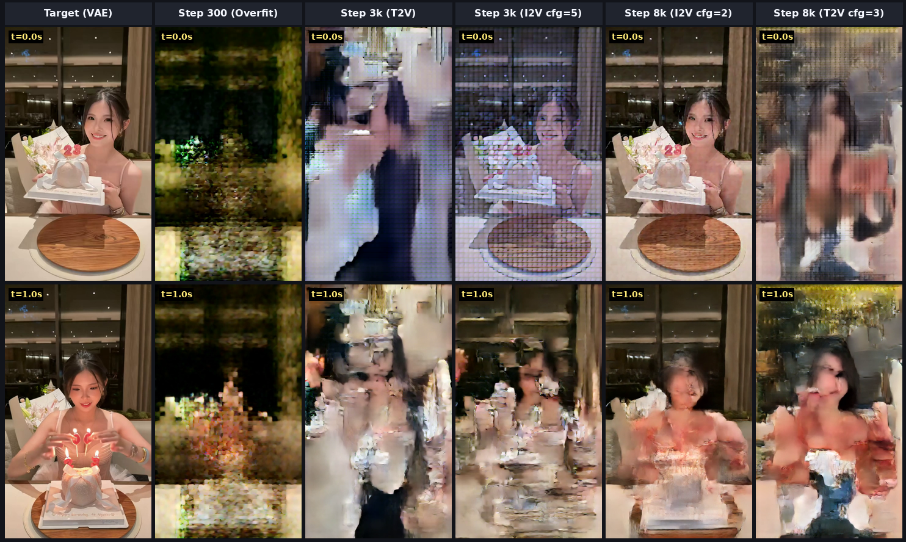

# VietH3 — Engineering & Training Progress Log

A complete record of building, curating, debugging, and training **VietH3** (`0.566B` single-stream Omni-DiT) from scratch on vertical `9:16` Vietnamese TikTok video data.

---

## 1. System Architecture Overview

- **Backbone:** `VietH3Transformer3DModel` ([`configs/model_vieth3_tiktok_9x16_mini.yaml`](../configs/model_vieth3_tiktok_9x16_mini.yaml)) — **`566,340,544` (`0.566B`) parameters**, 16 single-stream layers + 2 refiner layers (`hidden_size=1152`, `9` heads × `128` head dim, `ffn_dim=3072`, `qk_norm=true`, 3D RoPE).
- **Training Objective:** Rectified Flow (`flow_shift=5.0`) supporting joint **Image-to-Video (Frame-0 anchor)** and **Text-to-Video** (`i2v_dropout=0.1` → 90% I2V / 10% T2V; `cfg_dropout=0.1`).
- **Conditioning & Latent Space (Frozen):**
  - **Video VAE:** `Wan2.1-VAE` (`Wan-AI/Wan2.1-T2V-1.3B-Diffusers`, 16 latent channels, `4×` temporal × `8×` spatial compression).
  - **Vietnamese Text Encoder:** Native `Qwen/Qwen2.5-VL-7B-Instruct` (`text_dim=3584`, `max_text_len=256`).

---

## 2. Milestone 1 — Dataset Curation & The OpenCV → Multimodal LLM Pivot

Raw TikTok feeds contain heavy camera shake, jump cuts, black letterbox bars, strobe lighting, and text clutter. We tested two filtering strategies across **181 downloaded portrait clips**:

### Problem With Heuristic CV Thresholds
In [`src/vieth3/data/filters.py`](../src/vieth3/data/filters.py), strict OpenCV thresholds (`max_bg_motion=0.25`, `min_sharpness=40.0`) rejected **75.7%** of clips:
- Sampling 8 frames per `121f` clip (`~0.7s` jumps) caused normal foreground skirt/arm motion or exposure shifts to register as `0.30–0.80` background optical flow.
- Whole-frame Laplacian variance punished sharp dancers filmed against clean, plain bedroom walls (`20–38`).

| Screening Method | Input Clips | Clean Passing Clips | Outcome |
| --- | ---: | ---: | --- |
| Strict OpenCV heuristic (`bg <= 0.25`, `sharp >= 40`) | 181 split clips | **39** (`~24%`) | Over-rejected clean tripod clips |
| Relaxed CV sweep (`bg <= 0.80`, `sharp >= 25`) | 181 split clips | 80 (`44.2%`) | Still arbitrary edge/flow trade-offs |
| **Parallel Multimodal LLM Contact-Sheet Review** (`7 × flash_lite`) | 131 unreviewed clips + prior 39 | **146 unique URLs** (`81.7%` recovery on unreviewed) | Clean visual QA across `2×4` frame strips |

### Final Curated Pilot Dataset (`data/urls_tiktok.txt`)
- **Verified URLs:** **146** (`54` unique creators, max `5`/creator)
- **Raw MP4s:** `272.6 MB` (`0.27 GB`)
- **24 fps `Wan2.1`-Grid Clips:** **150 clips** (`17,882` frames = **`12.4 min` / `0.21 hrs`**, `323.2 MB`)
- **Visual Rejection Breakdown (24 dropped):** `static_talking_head` (12), `dark_or_blurry` (7), `jump_cut` (2), `shaky_camera` (2), `heavy_text_overlay` (1).

---

## 3. Milestone 2 — Offline Cluster Pipeline & Preflight

Running on the **NUS SoC Slurm Compute Cluster** (without external AI access on the cluster nodes):

1. **Offline Local Captions (`recaption_vi.py --backend local`):** Added direct `transformers` `Qwen2_5_VLForConditionalGeneration` inference in `bfloat16` so cluster runs don't require a separate `vLLM` server. Fixed missing `torchvision` (`torchvision==0.21.0+cu124`) required by `Qwen2VLVideoProcessor`, producing **150/150** dense native Vietnamese captions.
2. **Latent Caching (`cache_latents`):** Encoded all `150` clips + Vietnamese embeddings into `data/cached_tiktok_480p/index.jsonl`.
3. **CUDA Pre-Flight (`scripts/h100_preflight.py`):**
   - `0.566B` params (`BF16` + gradient checkpointing)
   - Estimated peak VRAM: **`15.70 GB` / GPU** (`8.34 GB` measured in 2-step CUDA forward/backward check) — fits comfortably on both `H100-47GB` MIG and `H100-96GB`.

---

## 4. Milestone 3 — Verification Gate & 5× Speed Optimization

Before committing to a long run, we built [`scripts/verify_pipeline.sh`](../scripts/verify_pipeline.sh) as a fast sanity gate:

1. **Wan2.1-VAE Round-Trip (`outputs/verify/vae_roundtrip.mp4`):** Decoded a cached latent directly back to MP4 to verify RGB channel ordering, `(C, T, H, W)` shape, and latent normalization before training.
2. **4-Clip Overfit (`h100-47`):** First attempt on full `121`-frame clips (`48,360` tokens/clip) ran at **`32.1 s/step`** because 3D self-attention scales as $O(N^2)$ (`121f` = `t_lat=31` vs `49f` = `t_lat=13`, a **~5.7×** attention cost difference) on a half-SM MIG slice.
3. **Fix Applied (`--max-t-lat 13` + live `flush=True`):** Added on-the-fly temporal slicing in [`src/vieth3/data/dataset.py`](../src/vieth3/data/dataset.py) (zero re-caching) to train at `49` frames (`2.0s` @ `24 fps`) first:
   - Step time on `h100-47` (`bs=2, accum=1`) dropped **`32.1s → 6.59 s/step`** (**~4.9× faster**).
   - 300-step 4-clip overfit dropped loss cleanly **`1.5215 → 0.4138`** and reproduced the scene window, flowers, subject, and birthday candles (`overfit_sample.mp4`).

---

## 5. Milestone 4 — Pilot v1 Training Run (8,000 Steps on `1× H100-96GB`)

Using Slurm `-p gpu-long`, we trained from completely random DiT weights for **`8,000` steps** (`15h 02m` / `54,119.3s` total):

- **Config:** `model_vieth3_tiktok_9x16_mini.yaml` (`0.566B`), `BF16`, gradient checkpointing ON, `batch_size=4`, `grad_accum=1` (`~6.76 s/step` = **`1.70 s/clip`** at `480×832×49f`), `max_t_lat=13`, `lr=1e-4` (linear warmup `500` steps → cosine decay to `2.0e-5`), `use_ema=false`.

### Loss & Learning Rate Trajectory

| Step | Elapsed | LR | Velocity Loss | Phase / Observation |
| ---: | ---: | ---: | ---: | --- |
| `1` | `8.3s` | `2.00e-07` | `1.9111` | Random initialization |
| `200` | `22.5m` | `4.00e-05` | `0.4750` | Rapid early layout convergence |
| `400` | `45.0m` | `8.00e-05` | `0.2675` | Approaching peak warmup LR |
| `2000` | `3h 45m` | `9.24e-05` | `~0.165` avg | Stable Rectified Flow plateau |
| `3000` | `5h 38m` | `8.00e-05` | `~0.157` avg | Seen-clip I2V layout clear; T2V still abstract |
| `6000` | `11h 16m` | `3.32e-05` | `~0.11–0.13` avg | Cosine decay tightening structure (`0.014` on easy draws) |
| **`8000`** | **`15h 02m`** | **`2.00e-05`** | **`0.1149`** | Finished cleanly (`0.0127` min logged batch) |

### Visual Progression (`@nyokki1120` Seen Clip Evaluation)

#### Honest Assessment of Pilot v1 Outputs
- **What Worked Well:**
  - **End-to-end engineering is verified:** Zero NaNs across 15 hours; `vae_roundtrip.mp4` matches source crispness; seen-clip conditioning learns global geometry, room lighting, clothing/bouquet colors, cake tray, and temporal body/head motion.
  - **Huge jump from `3k → 8k`:** Notice `Step 3k (I2V cfg=5)` still showed heavy patch/grid artifacts even on `t=0.0s`, whereas **`Step 8k (I2V cfg=2)`** locks Frame 0 razor-sharp with zero checkerboard and reproduces the temporal transition (`t=0.0s` holding the cake → `t=1.0s` setting the cake down and lighting candles). Meanwhile, **`Step 8k (T2V cfg=3)`** (pure Vietnamese text, zero image reference, despite only ~800 T2V updates under `i2v_dropout=0.1`!) progressed from unreadable smears at `3k` to recognizable seated human posture, dark hair, shoulders, and room background.
- **Current Limitations:**
  - Fine facial features and fingers remain soft/painterly — expected when training a `0.566B` DiT **from random initialization** on only **`150` clips (`12.4 min`)** without EMA (`use_ema: false`).

---

## 6. Key Lessons & Next Directions

1. **Don't run long cluster jobs blind:** Always verify data round-trip + a 10–30 minute 4-clip overfit gate before committing 15–24 hours of GPU allocation.
2. **Temporal token scaling matters most:** `49f` vs `121f` (`5.7×` compute difference) + `--grad-accum 1` kept `1× H100` iteration fast enough (`6.76 s/step`) to inspect checkpoints every ~1.9 hours.
3. **Two clear paths forward from Pilot v1:**
   - **Path A (Scale From-Scratch VietH3):** Expand dataset from `146` → **`1,000–3,000+` clean clips**, enable **`use_ema: true`** in [`train_tiktok_9x16_480p.yaml`](../configs/train_tiktok_9x16_480p.yaml), train a fast **`256×448` Stage 1** first (`~6×` faster) before `480p`, and evaluate on held-out prompts/frames.
   - **Path B (Immediate Photorealism):** Keep the exact same curated `146+` clips and Vietnamese captions, and **LoRA / fine-tune a pretrained `Wan2.1-1.3B` (or H3) backbone** on `1× H100` (~2–4 hours) rather than learning human anatomy from random weights.
